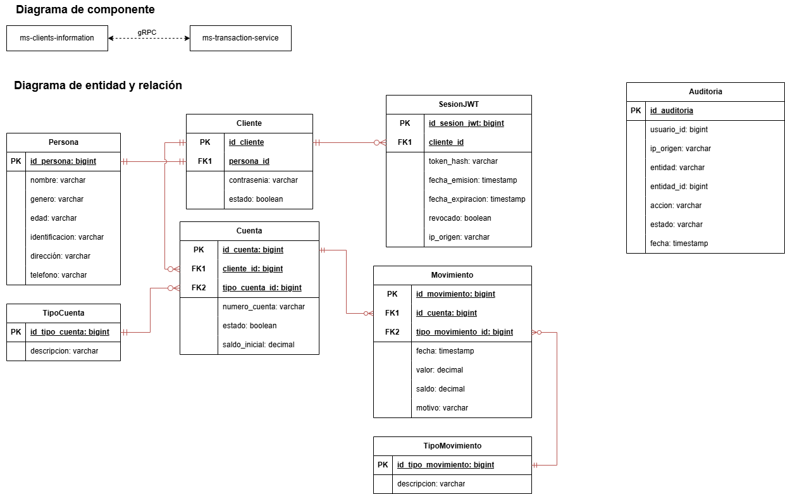

# Prueba MS — Banca (Clientes + Transacciones)

Sistema bancario simple compuesto por **dos microservicios independientes**, cada uno con su propia base de datos PostgreSQL, comunicados entre sí por **gRPC** y expuestos al exterior por **REST + JWT**.

| Microservicio                                                  | Puerto REST | Puerto gRPC      | Base de datos     | Para qué sirve                                                          |
| -------------------------------------------------------------- | ----------- | ---------------- | ----------------- | ----------------------------------------------------------------------- |
| [`ms-client-service`](./ms-client-service/README.md)           | 8080        | 9090 (servidor)  | `clients_db`      | Registro/login de clientes, emisión de JWT, catálogo de clientes        |
| [`ms-transaction-service`](./ms-transaction-service/README.md) | 8081        | — (cliente gRPC) | `transactions_db` | Cuentas, movimientos (depósitos/retiros) y reportes de estado de cuenta |

`ms-transaction-service` valida y consulta datos de clientes contra `ms-client-service` vía gRPC (no hay llave foránea física entre las dos bases de datos).

## Diagrama de componentes y modelo entidad-relación



## Contenido de este repo

```
banking-microservices-java/
├── docker-compose.yml              # Despliegue Swarm/Compose de los 2 microservicios (imagenes ya construidas)
├── ms-diagram.drawio.png           # Diagrama de componentes + modelo entidad-relacion
├── Prueba MS - Clientes y Transacciones.postman_collection.json
├── ms-client-service/              # Ver su propio README.md
└── ms-transaction-service/         # Ver su propio README.md
```

---

## Levantar con Docker Swarm (paso a paso)

`docker-compose.yml` está pensado para **Docker Swarm** con imágenes ya construidas — no usa `build:` (Swarm no construye imágenes en los nodos, necesita que ya existan). Si solo quieres probar todo junto en tu máquina sin Swarm, sigue igual los pasos 1-2 y en el paso 3 usa `docker compose up -d` en vez de `docker stack deploy` (Compose sí puede correr contra imágenes locales sin problema).

Requisitos:
- **Docker Desktop** instalado y corriendo.
- **PostgreSQL** instalado y accesible (en el host o en tu red) — este `docker-compose.yml` **no** incluye contenedores de Postgres, se asume que ya tienes uno. Crea las bases con el `BaseDatos.sql` de cada microservicio: `clients_db` (`ms-client-service/BaseDatos.sql`) y `transactions_db` (`ms-transaction-service/BaseDatos.sql`).

1. Construye las imágenes (una vez, o cada vez que cambies el código):

   ```bash
   docker build -t ms-client-service:latest ./ms-client-service
   docker build -t ms-transaction-service:latest ./ms-transaction-service
   ```
   > Si el swarm tiene más de un nodo, estas imágenes deben estar disponibles en todos los nodos (súbelas a un registry y referencia `usuario/imagen:tag` en `docker-compose.yml` en vez del nombre simple).

2. Define las variables de entorno que pide `docker-compose.yml` (no traen valores por defecto). La forma más simple es crear un archivo `.env` junto a `docker-compose.yml` (no se sube al repo):

   ```bash
   # .env
   DB_HOST=host.docker.internal   # o la IP/host de tu Postgres
   DB_PORT=5432
   DB_USER=postgres
   DB_PASSWORD=tu_password
   JWT_SECRET=una-clave-secreta-larga-y-aleatoria-de-al-menos-256-bits-para-hs256
   AES_SECRET=clave-aes-32-caracteres-exactos!!
   ```
   > Los nombres de las bases (`clients_db` / `transactions_db`) van fijos en `docker-compose.yml`, no son variables — son los que crea cada `BaseDatos.sql`.

   > ¿Solo quieres probar que todo levanta, sin pensar en tus propias claves? Ver [`docker-compose.override.yml`](#probar-rapido-con-valores-de-ejemplo) más abajo — trae valores de ejemplo y se aplica solo (nota: `docker stack deploy` **no** lee `docker-compose.override.yml` ni `.env` automáticamente — eso es solo para `docker compose up`; para Swarm exporta las variables en tu shell antes de desplegar).

3. Inicializa el swarm (si no lo has hecho) y despliega el stack:

   ```bash
   docker swarm init
   docker stack deploy -c docker-compose.yml banking
   ```
   Esto crea:
   - `ms-client-service` (puertos `8080` REST y `9090` gRPC)
   - `ms-transaction-service` (puerto `8081` REST)

4. Verifica el estado de los servicios y los logs:

   ```bash
   docker stack services banking
   docker service logs -f banking_ms-client-service
   docker service logs -f banking_ms-transaction-service
   ```

5. Verifica que responden:

   ```bash
   curl http://localhost:8080/api/clientes
   curl -i http://localhost:8081/api/cuentas   # 401 esperado sin token, confirma que esta arriba
   ```

   O abre en el navegador la documentación interactiva (Swagger UI) de cada uno:
   - http://localhost:8080/swagger-ui/index.html
   - http://localhost:8081/swagger-ui/index.html

6. Para bajar el stack:

   ```bash
   docker stack rm banking
   ```

### Probar rápido con valores de ejemplo (sin Swarm)

El repo incluye `docker-compose.override.yml` (no versionado, ver `.gitignore`) con valores de ejemplo listos para probar que todo levanta en Docker, sin crear tu propio `.env`. Es para `docker compose up` (no para `docker stack deploy`, que ignora los archivos override) — se combina automáticamente al correr `docker compose up -d` (no hace falta pasar `-f`). Asume Postgres corriendo en el host con `clients_db`/`transactions_db` ya creadas, alcanzable como `host.docker.internal` (así resuelve Docker Desktop al host), y que ya construiste las imágenes con el paso 1 de arriba.

---

## Importar/exportar la colección de Postman

El archivo `Prueba MS - Clientes y Transacciones.postman_collection.json` (en la raíz del repo) trae ya armado el flujo completo: crear cliente → login (guarda el token solo) → crear cuenta → crear movimiento → reporte, para ambos microservicios.

### Importar en Postman

1. Abre Postman.
2. **File → Import** (o el botón **Import** en la esquina superior izquierda).
3. Arrastra el archivo `Prueba MS - Clientes y Transacciones.postman_collection.json` a la ventana, o usa **Choose Files** y selecciónalo.
4. Postman crea la colección **"Prueba MS - Clientes y Transacciones"** con sus 4 carpetas (Clientes, Cuentas, Movimientos, Reportes) y las variables ya declaradas (`base_url_client`, `base_url_transaction`, `token`) — no hace falta configurar nada más, los `clienteId`/`numeroCuenta`/`cuentaId`/`movimientoId` se completan solos con los scripts de test de cada request al ejecutarlos en orden.

### Exportar (si modificas la colección y quieres guardar/compartir tus cambios)

1. En el panel izquierdo de Postman, click derecho sobre la colección **"Prueba MS - Clientes y Transacciones"** (o el botón **"···"** al pasar el mouse sobre ella).
2. Selecciona **Export**.
3. Elige el formato **Collection v2.1** (es el que usa este repo) y guarda.
4. Reemplaza el archivo `Prueba MS - Clientes y Transacciones.postman_collection.json` en la raíz del repo con el que acabas de exportar.
